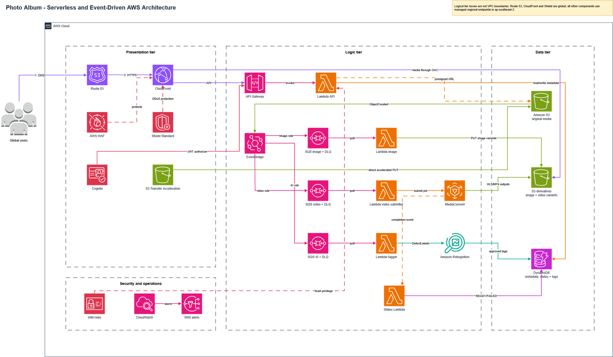
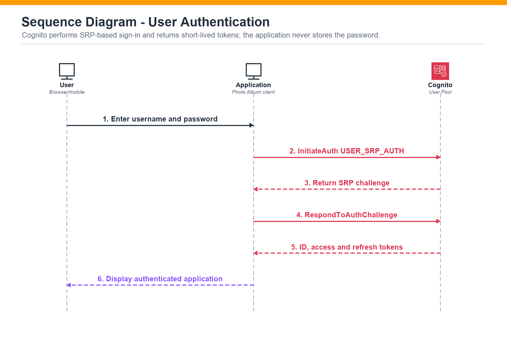
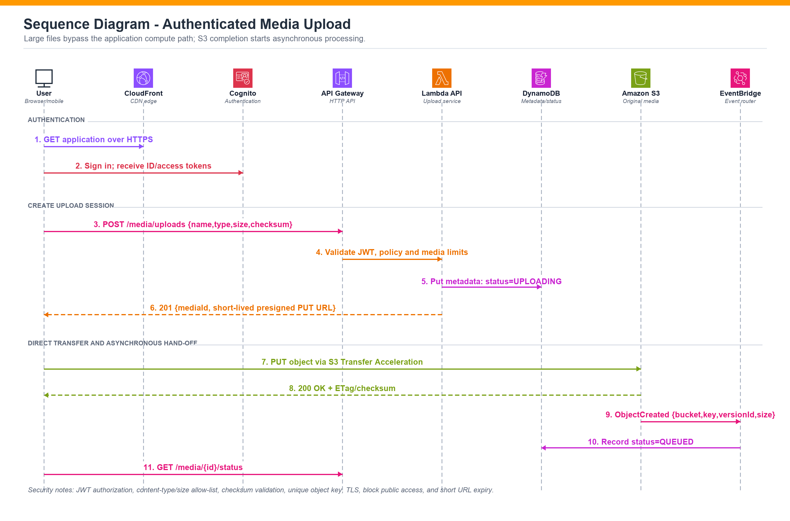
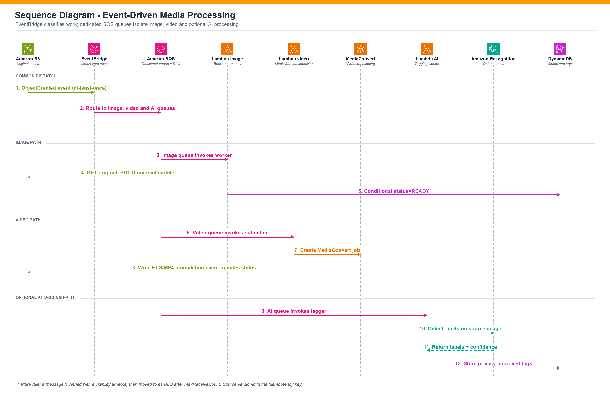
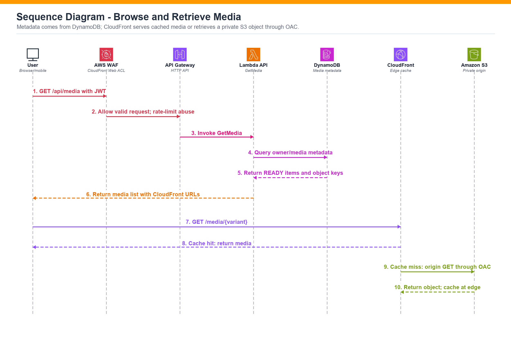

# Globally Scalable Photo Album — Serverless AWS Architecture

**COS20019 · Cloud Computing Architecture · Group architecture proposal**

A proposed AWS architecture for a photo album facing fast growth and slow international response times. The design moves uploads directly to Amazon S3, serves media through CloudFront, and processes images, video, and optional AI tags through separate event-driven queues. The [full 15-page report](Proposal.pdf) contains the requirements, assumptions, calculations, references, and implementation plan.

> **Project scope:** This is a design and quantitative evaluation, not a deployed application. Costs, performance targets, and scaling figures are projections rather than measured production results.

## At a glance

| Design area | Proposal |
| --- | --- |
| Global delivery | Route 53, CloudFront, AWS WAF, and Shield Standard |
| Identity and API | Amazon Cognito, API Gateway HTTP API, and AWS Lambda |
| Storage | Private S3 buckets for media; DynamoDB on-demand for metadata and status |
| Upload | A short-lived presigned URL sends files directly from the client to S3 |
| Processing | S3 ObjectCreated → EventBridge → dedicated SQS queues → image Lambda, video submitter/MediaConvert, or optional Rekognition tagging |
| Reliability | Retries, dead-letter queues, idempotent status updates, S3 versioning, DynamoDB point-in-time recovery, and CloudWatch alarms |

## Architecture

The API handles authentication, metadata, and upload-session creation. Media bytes bypass the API. Once S3 confirms an upload, EventBridge routes the event to independent queues so a video or AI backlog cannot block image resizing. CloudFront caches published media near users and reads private S3 objects through Origin Access Control.

## Key interaction diagrams

### 1. Authenticate and upload

Cognito issues tokens, API Gateway validates the JWT, and Lambda returns a media ID and presigned S3 URL. The client uploads the original directly to S3. The upload-session response does not mean the media is ready; processing starts after S3 confirms the upload.

### 2. Process media independently

Image workers create thumbnail and mobile variants. A separate Lambda submits video jobs to MediaConvert. Optional Rekognition tagging has its own queue and can be disabled. Source version IDs, immutable output keys, conditional DynamoDB writes, retries, and dead-letter queues address duplicate events and failed processing.

### 3. Browse and retrieve

The API returns owned media metadata and CloudFront URLs for ready items. CloudFront serves a cache hit at the edge or fetches a private S3 variant on a miss.

## Evaluation in the report

The planning baseline assumes **50,000 monthly active users**, **10 million API requests**, **100,000 photo uploads**, **1 TB of S3 storage**, and **5 TB of monthly CloudFront transfer**. Under those assumptions, the report estimates **US$1,031.94 per month**. Its three-year scenario assumes demand doubles every six months:

| Scenario | Demand | Estimated monthly cost | Estimated cost per active user |
| --- | ---: | ---: | ---: |
| Baseline | 1× | US$1,032 | US$0.0206 |
| After 24 months | 16× | US$15,234 | US$0.0190 |
| After 36 months | 64× | US$56,313 | US$0.0176 |

In the report's weighted design comparison, serverless scores **4.65/5**, containers **3.65/5**, and EC2 Auto Scaling **2.65/5** for this workload and its stated priorities. These are analytical scores, not benchmark results. The report defines acceptance tests for API latency, queue drain time, cache hit rate, failure recovery, security, and cost accuracy.

## Trade-offs and next steps

The initial design uses one AWS Region (Sydney) with a global edge. It covers Availability Zone failures through managed services, while cross-Region recovery is a proposed later phase. Video transcoding and AI tagging are optional extensions excluded from the baseline cost. The recommended next step is an infrastructure-as-code proof of concept followed by burst, failure, security, and cost tests.

## My contribution and team

**Le Thanh Hoang Minh:** Architecture design and requirements traceability; reviewed the full report and presented the architecture and its boundaries. This contribution is recorded in the report's group contribution table.

This was a group submission with **Quang Huy Tran** (service rationale, security, reliability), **Chau Chanh Nghi** (sequence diagrams, cost, quantitative evaluation), and **Chung Hien Thong** (alternatives, testing plan, final editing). All members reviewed the full report.

**[Download or view the complete assignment PDF](Proposal.pdf)** for the detailed design, source assumptions, calculations, and references.
